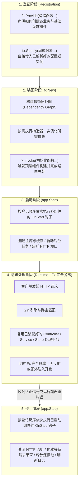
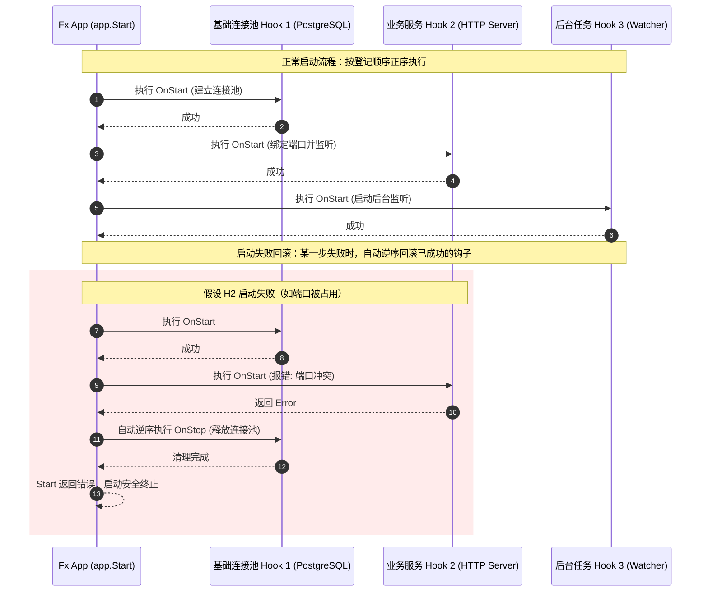
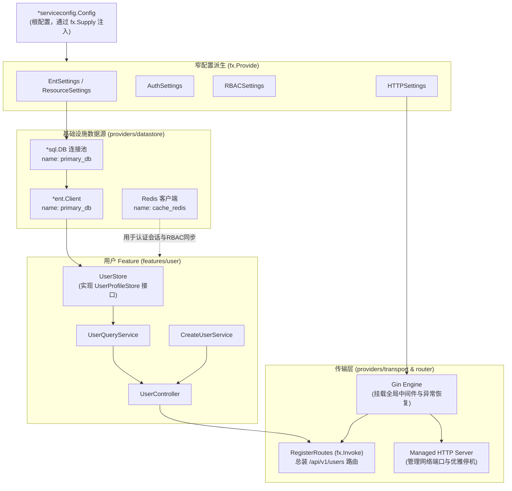
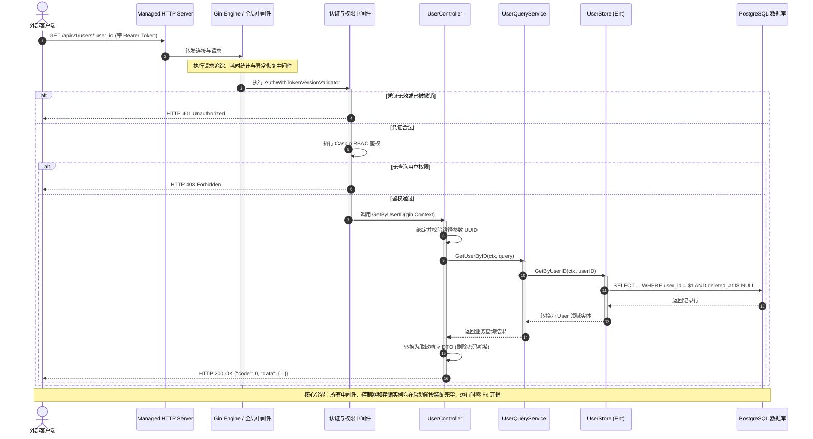

# Uber Fx v1.24.0 完整教程与工程实践

本文以 [`user-service/go.mod`](../user-service/go.mod) 锁定的 **v1.24.0** 为准，覆盖 `fx`、`fxevent` 和 `fxtest` 三个公开包，不包含内部实现或 Dig 自身的 API。教程写法参考官方 [Result Objects](https://uber-go.github.io/fx/result-objects.html)。

## 阅读导航

1. [核心概念与流程](#核心概念与流程)：理解依赖注入、按需构造和生命周期流转机制。
2. [入门练习](#入门练习)：从登记构造器开始，逐步递进到多结果提供和 HTTP 服务启停。
3. [Fx API 分类参考](#fx-api-分类参考)：按用途查阅核心 API，包含值组、钩子注解和事件日志。
4. [排错实战与常见异常剖析](#排错实战与常见异常剖析)：典型报错日志、成因分析与 `fxgraph` 可视化排查。
5. [项目实战：查一条用户资料](#项目实战查一条用户资料)：追踪 `GET /api/v1/users/:user_id` 的全景装配拓扑与请求执行链路。
6. [项目装配规范与分类指南](#项目装配规范与分类指南)：团队统一约定的 8 大 Fx 装配分类与 5 大架构铁律。
7. [公开函数与方法索引](#公开函数与方法索引)：按包查阅所有公开函数、方法与签名的速查手册。

---

## 核心概念与流程

- **依赖注入（Dependency Injection）**：把准备好的组件（如数据库连接池、日志器）作为参数直接交给使用者，而不是让使用者自己在函数内部创建或到处寻找全局变量。
- **构造器（Constructor）**：负责创建组件的普通 Go 函数（如 `NewUserStore`、`NewGinEngine`）。
- **容器与依赖图（Container & Dependency Graph）**：Fx 容器记录哪些构造器能提供哪些类型。函数的参数与返回值构成一张有向无环依赖图（DAG），Fx 沿图按需调用构造器，并在同一个 `*fx.App` 中天然复用结果（单例模型）。
- **生命周期与钩子（Lifecycle & Hooks）**：生命周期指应用从初始化、启动到停止的全过程；钩子（`OnStart` / `OnStop`）是在指定阶段触发的回调函数。

小程序往往可以手写代码逐个创建对象。但在复杂的微服务架构中，多个功能共享连接池、缓存、日志与监控，且需要协调依赖顺序并在停机时优雅释放资源。Fx 通过自动化图解析，极大减少了手写胶水代码和编排清理顺序的负担。

### Fx 核心工作流

下图展示了一个 Fx 应用从参数登记、依赖图构建、生命周期启动，到处理业务请求，最后优雅停机的完整流转：



### 生命周期钩子执行机制与回滚保障

在启动过程中，Fx 严格按照钩子的**登记顺序**串行调用 `OnStart`；在停止时，则按照**完全相反的顺序**调用已成功启动项的 `OnStop`。

当某个组件在启动过程中发生错误时，Fx 具备自动保护机制：它会立即中断启动，并逆序执行此前已经成功执行过 `OnStart` 的组件的 `OnStop`，确保先打开的网络端口或数据库连接被干净回收，防止资源泄漏：



> **标注约定**：本文用 **运行** 标注项目服务或工具的实际生产用法，用 **测试** 标注仅在仓库自动化测试中使用的做法，用 **补充** 标注教程为了讲解概念特设的演示用法。

---

## 入门练习

独立 Go 示例可在仓库外的空目录使用 Go 1.22+ 运行，不需要 Nacos、数据库或 Redis。每次运行只保留一个完整的 `package main` 示例；测试示例放在 `*_test.go` 中。

### 第 1 步：登记构造器并观察调用

用一段最小的 Go 程序观察 Fx 何时创建依赖。

```go
package main

import (
	"fmt"
	"log"

	"go.uber.org/fx"
)

// Store 用一条内存数据代替数据库，让我们只观察 Fx 何时创建它。
type Store struct {
	Name string
}

// newStore 不需要任何依赖。它的返回类型告诉 Fx：这个函数能提供 *Store。
// 这行打印只有在函数真的被调用时才会出现，登记函数时不会打印。
func newStore() *Store {
	fmt.Println("1. create store")
	return &Store{Name: "Alice"}
}

// main 只演示装配阶段，不启动 HTTP 服务，也不调用 App.Start。
func main() {
	// fx.New 接收下面的设置，完成登记，并同步执行要主动调用的函数。
	app := fx.New(
		// 关闭 Fx 自己的事件日志，不影响 fmt.Println 的输出。
		fx.NopLogger,
		// 传函数本身，告诉 Fx 如何得到 *Store；这里不直接调用 newStore()。
		fx.Provide(newStore),
		// 这个函数需要 *Store，Fx 找到 newStore 并调用它，再传入结果。
		fx.Invoke(func(store *Store) {
			fmt.Println("2. use store:", store.Name)
		}),
	)
	// fx.New 返回应用对象，不单独返回 error。用 Err 读取装配错误。
	if err := app.Err(); err != nil {
		log.Fatal(err)
	}
}
```

在示例目录执行（版本与项目相同；`go mod init` 和 `go get` 只需首次执行）：

```bash
go mod init fx-tutorial
go get go.uber.org/fx@v1.24.0
go run .
```

输出：
```text
1. create store
2. use store: Alice
```

**关键点解析：**
1. `fx.Provide(newStore)` 登记的是**函数本身**，而不是直接执行的 `newStore()`。
2. `fx.Invoke(...)` 要求 Fx **主动执行目标函数**。Fx 分析其入参发现依赖 `*Store`，于是按图索引并执行 `newStore`，将结果传过去。这个调用发生在 `fx.New` 装配期内。
3. 若把 `fx.Invoke(...)` 删掉重新运行，控制台将空无一物。**仅有登记、无人消费，构造函数绝不会被盲目执行**。

**对应项目源码：** [`features/user/fx.go` 的 `Module`](../user-service/internal/features/user/fx.go) 登记了 `NewUserController`；[`providers/transport/fx.go` 的 `RuntimeModule`](../user-service/internal/providers/transport/fx.go) 通过 `fx.Invoke(RegisterRoutes)` 要求执行路由总装，进而触发 Fx 创建它所依赖的用户控制器与下层服务。

---

### 第 2 步：用 `fx.Out` 提供两个结果

**结果对象（Result Object）** 是专门携带构造结果的结构体。这里让 `newStore` 一次性提供数据查询和统计能力，两个字段指向**同一个对象**，供不同需求方各取所需。

保留上一例的包名、导入和 `Store` 定义，用以下代码替换 `newStore` 和 `main`：

```go
// StatsSource 只要求能读取记录数，使用方不必知道背后是哪个具体的存储实现。
type StatsSource interface {
	Count() int
}

// Count 把示例里的非空姓名当成一条有效记录；演示业务计算。
func (s *Store) Count() int {
	if s.Name == "" {
		return 0
	}
	return 1
}

// StoreResult 把一次构造得到的值分别交给不同的使用者。
type StoreResult struct {
	// fx.Out 标记：供 Fx 容器读取的是下面的导出字段，而不是 StoreResult 整体。
	fx.Out

	Store *Store
	Stats StatsSource `name:"user_stats"` // 以 StatsSource 接口类型、user_stats 名称提供。
}

// newStore 仍然只创建一次 *Store。直接返回 StoreResult 值类型，不要返回指针。
func newStore() StoreResult {
	fmt.Println("1. create store")
	store := &Store{Name: "Alice"}
	// *Store 实现了 Count，因此也能作为 StatsSource。两字段共享同一个实例。
	return StoreResult{Store: store, Stats: store}
}

// InspectParams 列出 inspect 需要的依赖，Fx 会逐字段填入对应的值。
type InspectParams struct {
	// fx.In 是参数标记，告诉 Fx 从容器中按字段注入。
	fx.In

	Store *Store
	Stats StatsSource `name:"user_stats"` // 类型和名称都要与提供方匹配。
}

// inspect 是 fx.Invoke 的调用目标。Fx 填好参数后运行它，不会将其返回值作为依赖。
func inspect(p InspectParams) {
	fmt.Printf("2. use store: %s (%d record)\n", p.Store.Name, p.Stats.Count())
}

// main 登记构造器并要求运行 inspect；字段自身的变量名不影响匹配。
func main() {
	app := fx.New(fx.NopLogger, fx.Provide(newStore), fx.Invoke(inspect))
	if err := app.Err(); err != nil {
		log.Fatal(err)
	}
}
```

运行输出：
```text
1. create store
2. use store: Alice (1 record)
```

**关键点解析：**
1. 结构体嵌入 `fx.Out`，大写导出的字段会被 Fx 分别放入容器中。`newStore` 返回的是结构体值（Value），外界不能直接请求 `StoreResult` 整体，而是按字段类型（`*Store` 或带名字的 `StatsSource`）索取。
2. 结构体嵌入 `fx.In`，像一张物资领用单：Fx 匹配字段的类型；若写了 `name:"..."` 标签，则类型和名称必须同时吻合。
3. 如果把 `InspectParams.Stats` 的标签改为 `name:"other_stats"`，应用在 `fx.New` 阶段就会直接报错退出，提示缺少名为 `other_stats` 的依赖。

**对应项目源码：** [`features/auth/fx.go` 的 `TokenVersionLocalCacheResult` 与 `newTokenVersionLocalCache`](../user-service/internal/features/auth/fx.go) 使用了完全一致的模式。它用 `fx.Out` 同时导出 `Cache`（供中间件版本校验）和 `Stats`（供指标采集器 [`RuntimeDependencyMetricsParams`](../user-service/internal/providers/observability/metrics.go)）。两者都打上了 `name:"auth_token_version_cache"` 标签，但类型各异，既保持了单例共享，又解耦了职责。

---

### 第 3 步：注册路由并在启动时监听

沿用存储组件，将其传递给 HTTP 处理函数，并使用**生命周期钩子（Lifecycle Hooks）**控制服务器的安全启停。本练习使用 Go 1.22+ 标准库的 `http.ServeMux` 匹配路径，用 `httptest.NewServer` 模拟启动本地测试服务器。

在导入区加上 `context`、`encoding/json`、`net/http`、`net/http/httptest` 和 `time`，更新代码如下：

```go
// registerRoutes 由 Fx 在装配阶段调用一次，将处理函数挂载到现有路由器。
func registerRoutes(mux *http.ServeMux, store *Store) {
	fmt.Println("2. register route")
	mux.HandleFunc("GET /demo/users/{user_id}", func(w http.ResponseWriter, r *http.Request) {
		// 以下代码由 HTTP 路由器在每次接收到外部请求时执行，不是 Fx 在运行。
		// store 是在挂载路由时闭包捕获的对象，每个请求直接复用它。
		w.Header().Set("Content-Type", "application/json")
		_ = json.NewEncoder(w).Encode(map[string]string{
			"user_id": r.PathValue("user_id"),
			"name":    store.Name,
		})
	})
}

// Runtime 保存监听中的测试服务器；装配完成但尚未启动时，Server 仍为空。
type Runtime struct {
	Server *httptest.Server
}

// newRuntime 接收 Fx 内建的生命周期登记器和已装配的路由器。
// 构造阶段只登记启停动作，绝不提前打开网络端口。
func newRuntime(lc fx.Lifecycle, mux *http.ServeMux) *Runtime {
	runtime := &Runtime{}
	lc.Append(fx.Hook{
		OnStart: func(context.Context) error {
			// App.Start 走到这个回调才真正监听网络端口。
			runtime.Server = httptest.NewServer(mux)
			fmt.Println("3. start listening")
			return nil
		},
		OnStop: func(context.Context) error {
			// App.Stop 走到这个回调时关闭监听，释放网络资源。
			if runtime.Server != nil {
				runtime.Server.Close()
			}
			fmt.Println("5. stop listening")
			return nil
		},
	})
	return runtime
}

// main 驱动生命周期，并用普通 HTTP 客户端发出一条测试请求。
func main() {
	var runtime *Runtime
	app := fx.New(
		fx.NopLogger,
		// Module 给这组选项命名；Provide 登记构造器，Invoke 触发挂载路由。
		fx.Module("demo", fx.Provide(newStore, http.NewServeMux, newRuntime),
			fx.Invoke(registerRoutes)),
		// &runtime 是目标变量地址。Fx 在装配阶段解析 *Runtime 并将其赋值。
		fx.Populate(&runtime),
	)

	// 给 Start 传入截止时间预算；它不限制上面已经完成的 fx.New。
	ctx, cancel := context.WithTimeout(context.Background(), 5*time.Second)
	defer cancel()
	if err := app.Start(ctx); err != nil {
		log.Fatal(err)
	}

	// 发起 HTTP 请求走标准网络协议，不经过 Fx。
	client := &http.Client{Timeout: 5 * time.Second}
	resp, requestErr := client.Get(runtime.Server.URL + "/demo/users/42")
	if requestErr == nil {
		var body map[string]string
		requestErr = json.NewDecoder(resp.Body).Decode(&body)
		resp.Body.Close()
		if requestErr == nil {
			fmt.Printf("4. HTTP %d: %s (%s)\n", resp.StatusCode, body["name"], body["user_id"])
		}
	}

	// 停止时使用崭新的 Context 预算，防止复用可能已被取消或超时的启动 context。
	stopCtx, stopCancel := context.WithTimeout(context.Background(), 5*time.Second)
	defer stopCancel()
	if err := app.Stop(stopCtx); err != nil {
		log.Fatal(err)
	}
	if requestErr != nil {
		log.Fatal(requestErr)
	}
}
```

输出：
```text
1. create store
2. register route
3. start listening
4. HTTP 200: Alice (42)
5. stop listening
```

**对应项目源码：** [`bootstrap/app.go` 的 `registerRuntimeServers`](../user-service/internal/bootstrap/app.go) 通过 `fx.Invoke` 解析 `*HTTPRuntime` 和 `*PprofRuntime`。业务服务的 [`NewHTTPServer`](../user-service/internal/bootstrap/server.go) 接收已装配的 Gin 引擎，用 `lc.Append` 登记启停钩子；[`cmd/serve.go` 的 `runServe`](../user-service/cmd/serve.go) 则负责最终调用 `app.Start` 与 `app.Stop`。

---

## Fx API 分类参考

- **选项 `fx.Option`**：传给 `fx.New` 的配置指令，应用创建后不可更改。`Option.String() string` 返回选项的文字描述。
- **注解 `fx.Annotation`**：传给 `Annotate` 的匹配修饰规则。
- **常量（补充）**：`fx.Version` 是版本号字符串，`fx.DefaultTimeout` 是默认启停预算（`15s`）。

下文未另行标注返回值的选项函数均返回 `fx.Option`。

### 登记、匹配和取值

| API | 核心功能与执行时机 | 本项目中的实战例子 |
| --- | --- | --- |
| `fx.New(opts...)` / `app.Err()` | `New` 接收选项列表，执行参数校验、构建依赖图并触发 `Invoke`；不执行启停钩子。`Err` 读取装配阶段的错误。 | `bootstrap.NewApp` 构建主应用；`fxgraph.RenderDOT` 借助 `Err` 判断依赖图是否完整。 |
| `fx.Provide(constructors...)` / `fx.Supply(values...)` | `Provide` 登记构造器，有下游需要时才惰性创建并在此应用内单例复用。`Supply` 直接放入已有实例，无需构造。 | `NewUserController` 用 `Provide`；命令行读取完成的 `*serviceconfig.Config` 用 `Supply`。 |
| `fx.Invoke(functions...)` / `fx.Populate(&dest)` | `Invoke` 在 `New` 期间强制解析参数并执行函数，通常用于初始化或路由装配。`Populate` 把解析出的依赖直接赋值给外部变量指针。 | `RegisterRoutes` 用 `Invoke` 总装路由；图导出命令用 `Populate(&graph)` 读取依赖拓扑。 |
| `fx.Extract(&struct)` | 接收结构体指针，按类型填充导出字段。**已弃用**，新代码统一使用 `Populate`。 | **补充**：维护旧版本代码时识别。 |
| `fx.In` / `fx.Out` | 嵌入参数或结果结构体。`fx.In` 声明入参领用单，`fx.Out` 将结构体字段分别作为独立依赖发布到容器中。 | `RegisterRouteParams` 汇总路由输入；`TokenVersionLocalCacheResult` 分别提供校验与统计接口。 |
| `fx.Annotate(fn, annotations...)` | 为函数附加规则。`ParamTags` 标记输入，`ResultTags` 标记输出；`As` 声明以接口对外提供，`From` 声明按具体实现类型获取输入。 | 主库连接池与 Ent 的 `primary_db` 标签；`NewUserStore` 输出为 `UserProfileStore` 接口。 |
| `fx.Self()` / `fx.Annotated` | `Self` 配合 `As` 保留原实现类型。旧式 `Annotated{Name, Group, Target}` 为旧版写法。 | **补充**：新代码优先使用 `Annotate` 与 `fx.Out`。 |
| `fx.Module(name, opts...)` / `fx.Options(opts...)` / `fx.Private` | `Module` 建立具名作用域；`Options` 打包选项；`Private` 限制构造结果仅对当前模块及其子模块可见。 | `AppModule` 组合根模块；`permissionMetricsOptions` 限定内部指标组件不外泄。 |

### 可选值与值组（补充）

- **值组（Value Groups）**：用 `group:"name"` 将多个模块独立提供的同类型组件汇聚成一个切片（`[]T`）。值组内的元素顺序是不确定的；若业务有顺序需求，消费方应自行排序。
- **可选依赖（Optional）**：在 `fx.In` 的字段上标注 `optional:"true"`，若容器中没有该依赖，Fx 会填入零值（如 `nil`）而不会导致启动报错。
- **软消费（Soft）**：`group:"name,soft"` 表示仅收集已经被其他显式路径实例化的对象，不会为了填入该切片而主动触发提供者的构造。

```go
package main

import (
	"fmt"
	"log"
	"sort"
	"strings"

	"go.uber.org/fx"
)

type Reader interface{ Read() string }
type Store struct{ Name string }

func (s *Store) Read() string { return s.Name }

type Params struct {
	fx.In
	Reader Reader
	Store  *Store
	Label  string   `name:"label"`
	Items  []string `group:"items"`
	Extra  []string `group:"extra,soft"`
	Limit  *int     `optional:"true"`
}

func main() {
	app := fx.New(
		fx.NopLogger,
		// Supply 放入现成值；Replace 用同一个类型和名称替换它。
		fx.Supply(fx.Annotated{Name: "label", Target: "dev"}),
		fx.Replace(fx.Annotate("demo", fx.ResultTags(`name:"label"`))),
		fx.Provide(
			// As + Self 同时暴露接口类型和具体实现类型，两类型指向同一个对象。
			fx.Annotate(func() *Store { return &Store{Name: "Alice"} },
				fx.As(new(Reader)), fx.As(fx.Self())),
			// flatten 展开切片，让切片中的每个元素分别加入 items 值组。
			fx.Annotate(func() []string { return []string{"B", "A"} }, fx.ResultTags(`group:"items,flatten"`)),
			fx.Annotate(func() string { return "C" }, fx.ResultTags(`group:"items"`)),
			// extra 标注了 soft，若无其他地方主动索取，此构造器不会被触发。
			fx.Annotate(func() string { return "lazy" }, fx.ResultTags(`group:"extra"`)),
		),
		fx.Module("display",
			// Decorate 装饰器：在 display 模块内修改 label 的值。
			fx.Decorate(fx.Annotate(strings.ToUpper, fx.ParamTags(`name:"label"`), fx.ResultTags(`name:"label"`))),
			fx.Invoke(func(p Params) {
				items := append([]string(nil), p.Items...)
				sort.Strings(items)
				fmt.Println(p.Label, p.Reader.Read(), p.Reader == p.Store, items, len(p.Extra), p.Limit == nil)
			}),
		),
	)
	if err := app.Err(); err != nil {
		log.Fatal(err)
	}
}
```

输出：`DEMO Alice true [A B C] 0 true`。

### 启停与退出

| API | 功能与时机 | 本项目中的实战例子 |
| --- | --- | --- |
| `fx.Lifecycle.Append(hook)` / `fx.Hook` / `fx.StopHook` | `Append` 接收 `Hook`（包含 `OnStart` 与 `OnStop`）。`StopHook(fn)` 把只有清理动作的函数包装成 `Hook`。 | HTTP 服务注册启停回调；日志器用 `StopHook` 在退出时刷盘（`Sync`）。 |
| `app.Start(ctx)` / `app.Stop(ctx)` | 分别正序执行 `OnStart`、逆序执行 `OnStop`，并使用调用方传入的 context 控制超时。 | `runServe` 在命令行入口中显式调用 `Start` 与 `Stop`。 |
| `fx.StartTimeout(duration)` / `fx.StopTimeout(duration)` / `app.Run()` | 设置 Fx 自带流程（如 `Run`）的默认启停预算。`Run` 阻塞运行直到系统信号并自动停机。 | `serve` 配置了两个预算值，但采用显式 `Start`、`Wait`、`Stop` 精细控制，没有使用 `Run`。 |
| `app.Wait()` / `fx.Shutdowner.Shutdown(opts...)` / `fx.ExitCode(code)` | `Wait` 返回退出通知通道。`Shutdown` 发出停机通知并携带退出码；通知不等于执行 `Stop`。 | HTTP 或 pprof 在运行期遇到严重故障时调用 `Shutdown(fx.ExitCode(1))`，通知外层主协程执行平稳停机。 |
| `app.Done()` / `fx.ShutdownSignal.String()` | `Done` 返回 `<-chan os.Signal`（仅系统信号）；要读取退出码使用 `Wait()`。 | **补充**：适合极简后台进程监听操作系统信号。 |
| `fx.OnStart(fn)` / `fx.OnStop(fn)` | 注解式钩子。被注解的构造函数在实际执行时自动附加生命周期钩子，构造器本身无需依赖 `fx.Lifecycle`。 | **补充**：适合编写不想引入 Fx 包依赖的通用纯业务组件。 |

#### 注解式钩子实战

```go
package main

import (
	"fmt"

	"go.uber.org/fx"
)

type Worker struct{}

func main() {
	fx.New(
		fx.NopLogger,
		fx.Provide(fx.Annotate(
			func(_ fx.Shutdowner) *Worker { return &Worker{} },
			// OnStart 钩子可直接消费构造器现有的入参。
			fx.OnStart(func(shutdown fx.Shutdowner) error {
				fmt.Println("start")
				return shutdown.Shutdown(fx.ExitCode(0))
			}),
			// OnStop 钩子可直接使用构造器产出的 Worker 实例。
			fx.OnStop(func(_ *Worker) { fmt.Println("stop") }),
		)),
		fx.Invoke(func(_ *Worker) {}), // 有消费者才会真正触发构造与钩子注册。
	).Run()
}
```

输出：
```text
start
stop
```

### 日志、诊断和测试

| API | 功能与时机 | 本项目中的实战例子 |
| --- | --- | --- |
| `fx.WithLogger(constructor)` / `fx.NopLogger` | `WithLogger` 让 Fx 自身事件接入指定的 `fxevent.Logger`。`NopLogger` 关闭 Fx 框架自身的事件输出。 | `AppOptions` 使用 `logger.NewFxEventLogger` 将框架事件接入 zap；练习使用 `NopLogger` 净化屏幕输出。 |
| `fx.RecoverFromPanics()` | 将依赖装配阶段构造器、装饰器或 `Invoke` 中的 panic 转换为普通 Go error 返回。 | `bootstrap.AppOptions` 默认开启，增强容错能力。 |
| `fx.DotGraph` / `fx.VisualizeError(err)` | `DotGraph` 是 Graphviz 格式的依赖图文本；`VisualizeError` 将装配错误转化为可视化拓扑图。 | `platform/runtime/fxgraph` 的 `RenderDOT` 导出拓扑，辅助架构分析。 |
| `fx.ValidateApp(opts...)` | 纯静态校验选项与依赖是否闭环，**不执行任何构造函数或初始化逻辑**。 | 架构静态检查与单元测试中验证依赖连线是否漏配。 |
| `fxtest.New(t, opts...)` / `RequireStart()` / `RequireStop()` | `fxtest` 是专门的测试工具包。自动重定向测试日志，启停失败立即终止当前测试（`FailNow`）。 | 端到端与集成测试中启动测试服务。 |
| `fxtest.NewLifecycle(t, opts...)` | 构造可独立驱动生命周期的测试登记器，无需搭建完整 Fx App。 | `postgres_test.go`、`ratelimit_test.go` 等单组件生命周期测试。 |

#### `fxevent` 事件日志

自定义 Fx 日志器只需实现 `fxevent.Logger` 的 `LogEvent(fxevent.Event)` 方法：

| 日志器或事件类型 | 核心用途与触发时机 |
| --- | --- |
| `fxevent.ZapLogger` | **生产运行**：将 Fx 框架事件接入 Zap，支持通过 `UseLogLevel` / `UseErrorLevel` 配置事件级别。 |
| `fxevent.ConsoleLogger` | **补充**：以人类可读的纯文本形式打印到标准输出（Fx 默认行为）。 |
| `fxevent.SlogLogger` | **补充**：接入 Go 1.21+ 标准库 `log/slog`。 |
| `Provided` / `Supplied` / `Decorated` / `Replaced` | 观察依赖的静态登记或替换情况（`Provided` 不代表已执行构造）。 |
| `BeforeRun` / `Run` / `Invoking` / `Invoked` | 观察构造器调用时序、耗时及是否发生错误。 |
| `OnStartExecuting` / `OnStartExecuted` | 精确定位慢启动钩子或在 `OnStart` 中卡住的具体函数。 |
| `Started` / `Stopping` / `Stopped` / `RollingBack` | 监控整体应用的生命周期切换与异常回滚过程。 |

---

## 排错实战与常见异常剖析

在实际开发与维护 Fx 驱动的应用时，遇到问题不必慌张。以下总结了 5 类最常见的错误现象、报错特征及标准解决路径：

### 1. 缺少依赖类型（Missing Type）

**报错特征：**
```text
could not build arguments for function "github.com/...":
  failed to build <target_function_params>:
    missing type: *github.com/.../Store
```
- **成因分析**：下游函数需要 `*Store`，但没有任何模块执行 `fx.Provide(NewStore)` 或 `fx.Supply(store)`。
- **排查步骤**：
  1. 确认该依赖的构造函数是否已在对应的 `fx.go` 中声明 `fx.Provide`；
  2. 确认声明该构造函数的模块（Module）是否被加入到了总入口（如 `AppModule` 或 `WiringModule`）；
  3. 若下游索取的是**接口类型**（如 `UserProfileStore`），检查构造器是否缺失了 `fx.Annotate(NewUserStore, fx.As(new(UserProfileStore)))`；
  4. 若使用了 `name:"..."` 标签，检查提供方与消费方的标签名字是否完全一致（大小写敏感）。

### 2. 依赖成环（Cycle in dependency graph）

**报错特征：**
```text
cycle in dependency graph:
  github.com/.../ServiceA depends on github.com/.../ServiceB
  github.com/.../ServiceB depends on github.com/.../ServiceA
```
- **成因分析**：组件 A 依赖组件 B，同时组件 B 又反向依赖组件 A。Fx 会在依赖拓扑构建阶段静态拦截此错误，拒绝启动。
- **解决原则**：**改变登记顺序无法解决依赖成环！**
  1. 提取公共下层能力：将 A 和 B 互相依赖的部分抽离为独立的服务或 Store C；
  2. 依赖倒置（DIP）：让其中一方依赖接口，通过事件广播（Pub/Sub）或注册回调的方式解除强耦合；
  3. 梳理业务边界，审视 A 和 B 的职责是否混淆。

### 3. 重复提供相同类型（Duplicate Provides）

**报错特征：**
```text
cannot provide function "NewPrimaryDB":
  already provides type *sql.DB from "NewSecondaryDB"
```
- **成因分析**：Fx 容器在默认情况下，同一种类型只能存在一个无名提供者。
- **解决原则**：
  - 针对相同类型但不同用途的对象（如主从数据库连接池），必须使用命名标签区分：
    ```go
    fx.Annotate(NewPrimaryDB, fx.ResultTags(`name:"primary_db"`))
    fx.Annotate(NewSecondaryDB, fx.ResultTags(`name:"secondary_db"`))
    ```
  - 若在测试中希望用 Mock 替换真实实例，不要用 `Provide`，而应使用 `fx.Replace`。

### 4. 构造函数声明了却从未被调用

**表现特征**：在构造函数内部写了 `fmt.Println` 或日志打印，启动时控制台却没有输出。
- **成因分析**：**Fx 是全惰性的**。如果注册的构造函数产出的类型，没有被任何 `fx.Invoke`、`fx.Populate` 或其他被活跃消费的组件直接/间接依赖，Fx 就不会执行该函数。
- **解决原则**：检查该组件是否应该挂载在某个流程中。例如控制器（Controller）必须被 `RegisterRoutes` 接收并挂载到路由上，路由又必须被 `fx.Invoke(RegisterRoutes)` 显式触发。

### 5. 在构造函数中执行耗时 I/O 导致启动卡死

**表现特征**：`fx.New` 阶段卡死，或启停超时报错（`context deadline exceeded`），但堆栈不在 `OnStart` 中。
- **成因分析**：在构造函数内部直接调用了 `sql.Open` 之后的 `Ping`、同步连接外部 HTTP 服务、或同步加载巨大远程配置。构造函数不受 `StartTimeout` 预算的超时控制！
- **解决原则**：**构造函数只做内存对象的创建与依赖组装**。所有网络测通、握手、预热以及启动后台监听操作，一律放入 `Lifecycle.Append` 的 `OnStart` 回调中执行。

### 6. 实战利器：使用 `fxgraph` 导出与查看拓扑图

项目在 [`user-service/cmd/fxgraph.go`](../user-service/cmd/fxgraph.go) 中内置了构图命令行，可直接静态解析并导出完整的依赖拓扑关系：

```bash
# 1. 导出当前 user-service 的依赖拓扑图（默认输出到 ./docs/fx-dependency-graph.dot）
go run ./user-service/cmd fxgraph --config ./user-service/config/config.yaml

# 2. 如果本地已安装 graphviz 工具，可一键将其转为高清晰图片查看
dot -Tpng ./docs/fx-dependency-graph.dot -o ./docs/fx-dependency-graph.png
```

通过生成的 DOT 拓扑图，可以非常直观地排查是否有未接通的“孤岛节点”，或者意外依赖了不该依赖的高层组件。

---

## 项目实战：查一条用户资料

本节以用户服务核心接口 `GET /api/v1/users/:user_id` 为例，穿透跟踪整个用户服务在启动期如何通过 Fx 装配，以及在运行期如何处理单次 HTTP 查询请求。

### 用户服务核心依赖装配拓扑图

下图展示了从配置读取开始，直到 HTTP Server 启动就绪的完整依赖注入拓扑结构：



### 从 `serve` 到 `*fx.App` 的启动全过程

1. **命令行启动**：[`user-service/cmd/main.go`](../user-service/cmd/main.go) 启动 Cobra 命令树，执行 `serve` 命令，进入 [`cmd/serve.go` 的 `runServe`](../user-service/cmd/serve.go)。
2. **加载根配置**：`runServe` 在创建 Fx 容器之前，先通过共享配置体系从本地或 Nacos 读取并校验配置，得到 `*serviceconfig.Config`。**读取配置不走 Fx，配置失败时 Fx 应用尚未创建**。
3. **创建 Fx 容器**：`runServe` 调用 [`bootstrap.NewApp(cfg)`](../user-service/internal/bootstrap/app.go)。它通过 `fx.Supply(cfg)` 将根配置注入容器，并绑定派生配置函数、日志构造函数 `logger.NewLogger`，组合 `WiringModule` 与 `RuntimeModule`，最终通过 `fx.New(...)` 实例化应用。
4. **触发主动初始化**：在 `fx.New` 内部，按模块依赖顺序触发各个 `fx.Invoke`：
   - `InitProcessRuntime`：初始化全局时区；
   - `RegisterRoutes`：创建 Gin 引擎并完成全部 `/api/v1` 路由的挂载；
   - `registerRuntimeServers`：强制解析 `*HTTPRuntime` 与 `*PprofRuntime`，从而在生命周期中登记端口监听钩子。
5. **执行启动生命周期**：`runServe` 显式调用 `app.Start(startCtx)`，Fx 按序执行各组件的 `OnStart` 回调：测通主库与 Redis、启动 RBAC 同步 Watcher、最终业务 HTTP Server 绑定并监听端口。

### 一次查询请求穿透执行链路

当外部客户端调用 `GET /api/v1/users/018f6f3e-7c4d-7b2a-9f8a-4f6b1b2c3d4e` 时，请求将沿着启动期装配完毕的组件链顺次执行：



---

## 项目装配规范与分类指南

为了保持服务依赖拓扑的高可读性，防止团队成员在新增组件时职责混乱或滥用全局状态，`user-service` 在 [`bootstrap/app.go`](../user-service/internal/bootstrap/app.go) 中约定了标准化的 **Fx 注释与分类规范**：

### 8 大装配类别

每个 `fx.Provide` 或 `fx.Invoke` 前，必须紧跟 `// Fx 分类：<类别> - <职责>。` 格式的中文注释：

| 分类名称 | 核心职责 | 代表组件与示例 |
|---|---|---|
| **基础运行时** | 基础配置解析、派生窄 settings、进程级初始化与环境准备 | `InitProcessRuntime`（时区设置）、`NewRuntimeConfig`、`logger.NewLogger` |
| **资源** | 外部连接池、有状态基础设施客户端及工作池 | `ProvidePostgres`（`primary_db`）、`ProvideRedis`（`cache_redis`）、清理工作池 |
| **横切能力** | 跨 Feature 的安全、校验、分布式追踪、性能指标与健康检查 | `validation.Module`、`NewMetricsProvider`、`NewAPIRateLimiters`、`ProvideHealthChecks` |
| **Feature 基础设施** | 实现领域层存储端口的具体数据访问与第三方适配器 | `NewUserStore`、`newCredentialStore`、`NewRoleStore` |
| **Feature 应用** | 纯业务编排、Command 用例、Query 查询服务与领域能力 | `NewUserQueryService`、`NewLoginUseCase`、`NewRoleCommandService` |
| **传输** | 对外暴露的 HTTP 控制器、路由映射总装与 Web 引擎构建 | `NewUserController`、`RegisterRoutes`、`NewGinEngine`、`NewHTTPServer` |
| **生命周期** | 需要随进程启停主动执行的初始化动作、钩子注册或后台常驻任务 | `registerRBACLifecycle`（加载策略并启动 watcher）、`registerRuntimeServers` |
| **开发工具** | 仅在本地开发、诊断或构建期生效的辅助功能 | `NewPprofServer`、`platform/runtime/fxgraph`（导出依赖图） |

### 编写装配代码的五项铁律

1. **构造函数绝不执行阻塞 I/O**：`Provide` 中的构造函数只在内存中创建对象并绑定关系。建立网络连接、探测服务通断等耗时动作必须放入 `Lifecycle.Append` 的 `OnStart` 中，并严格遵守传入的 `context` 超时限制。
2. **使用接口解耦消费方**：基础设施存储应通过 `fx.Annotate(constructor, fx.As(new(Interface)))` 对外暴露抽象接口，应用层只依赖领域端口，不反向依赖具体的数据库实现。
3. **区分单例与上下文数据**：Fx 容器只管理无状态或长寿命的有状态单例服务；单次 HTTP 请求中的数据（如当前请求的用户凭证、请求 ID、Gin 上下文）通过中间件放入 `context.Context` 传递，绝不注入到 Fx 容器中。
4. **同类型多实例必须加命名标签**：当存在多个相同类型的连接池或客户端时（如主库 `primary_db` 与只读库、不同用途的 Redis 实例），必须使用 `ParamTags` 与 `ResultTags` 明确打标，避免容器匹配冲突。
5. **限制内部指标的可见性**：功能内部专用的指标或组件，使用 `fx.Private` 限制在私有子模块内，防止依赖泄露到外部模块。

---

## 公开函数与方法索引

以下逐项列出 **v1.24.0** 的公开函数和方法，包括接口方法。签名同时展示参数与返回类型。

### `fx`：装配与依赖匹配

| 函数与签名 | 用途 |
| --- | --- |
| `New(opts ...Option) *App` | 创建并装配应用，同步执行初始化，不运行启停钩子。 |
| `Provide(constructors ...interface{}) Option` | 登记构造器，有消费者需要结果时再调用。 |
| `Supply(values ...interface{}) Option` | 登记已有值，而非登记创建它的函数。 |
| `Invoke(funcs ...interface{}) Option` | 在装配时解析这些函数的参数并调用它们。 |
| `Populate(targets ...interface{}) Option` | 解析依赖并填入传入的变量地址。 |
| `Extract(target interface{}) Option` | 填充结构体指针的导出字段；已弃用，改用 `Populate`。 |
| `Module(name string, opts ...Option) Option` | 创建具名作用域，组织并限定部分选项的作用范围。 |
| `Options(opts ...Option) Option` | 打包多项设置，不创建新作用域。 |
| `Option.String() string` | 返回选项的文字描述。 |
| `Decorate(decorators ...interface{}) Option` | 用函数包装、改写已有依赖，不登记新的依赖键。 |
| `Replace(values ...interface{}) Option` | 用现成值替换已有依赖。 |
| `Annotate(t interface{}, anns ...Annotation) interface{}` | 给目标附加规则，返回可交给相应 Fx 选项的目标。 |
| `Annotated.String() string` | 返回旧式 `Annotated` 结构体的文字描述。 |
| `ParamTags(tags ...string) Annotation` | 按位置给输入添加标签。 |
| `ResultTags(tags ...string) Annotation` | 按位置给输出添加标签。 |
| `As(interfaces ...interface{}) Annotation` | 指定按哪些接口类型提供结果。 |
| `Self() any` | 返回供 `As` 使用的标记，保留原结果类型。 |
| `From(interfaces ...interface{}) Annotation` | 改变参数在依赖图中按哪种类型查找。 |

### `fx`：启停与退出

| 函数或方法与签名 | 用途 |
| --- | --- |
| `App.Run()` | 自动启动、等待退出通知并停止；需要自行管理退出时用显式方法。 |
| `App.Start(ctx context.Context) error` | 使用传入的 context 执行启动钩子。 |
| `App.Stop(ctx context.Context) error` | 使用传入的 context 按逆序执行适用的停止钩子。 |
| `App.Wait() <-chan ShutdownSignal` | 获取退出通知通道，可读取系统信号与退出码。 |
| `App.Done() <-chan os.Signal` | 获取只携带系统信号的退出通知通道。 |
| `StartTimeout(v time.Duration) Option` | 设置应用默认启动预算。 |
| `StopTimeout(v time.Duration) Option` | 设置应用默认停止预算。 |
| `App.StartTimeout() time.Duration` | 读取默认启动预算，不执行启动。 |
| `App.StopTimeout() time.Duration` | 读取默认停止预算，不执行停止。 |
| `Lifecycle.Append(hook Hook)` | 登记钩子，不立即执行。 |
| `StartHook[T HookFunc] (start T) Hook` | 将启动函数包装成只有 `OnStart` 的钩子。 |
| `StopHook[T HookFunc] (stop T) Hook` | 将停止函数包装成只有 `OnStop` 的钩子。 |
| `StartStopHook[T1 HookFunc, T2 HookFunc] (start T1, stop T2) Hook` | 将一对启停函数包装为一个钩子。 |
| `OnStart(onStart interface{}) Annotation` | 为被注解的构造器关联启动钩子。 |
| `OnStop(onStop interface{}) Annotation` | 为被注解的构造器关联停止钩子。 |
| `Shutdowner.Shutdown(...ShutdownOption) error` | 发出退出通知，不替调用方执行 `Stop`。 |
| `ExitCode(code int) ShutdownOption` | 随退出通知携带退出码。 |
| `ShutdownTimeout(timeout time.Duration) ShutdownOption` | 已弃用，在本版无效；停止期限由 `Stop` 的 context 决定。 |
| `ShutdownSignal.String() string` | 返回信号的文字表示，不包含退出码。 |

### `fx`：日志与诊断

| 函数或方法与签名 | 用途 |
| --- | --- |
| `App.Err() error` | 读取装配错误，不启动应用。 |
| `ValidateApp(opts ...Option) error` | 检查所需依赖是否可解析，不执行构造器或初始化函数。 |
| `Error(errs ...error) Option` | 将已有错误加入选项并阻止装配。 |
| `ErrorHook(funcs ...ErrorHandler) Option` | 登记用于观察 `Invoke` 失败的错误处理器。 |
| `ErrorHandler.HandleError(error)` | 接收并记录或上报初始化错误，不消除该错误。 |
| `RecoverFromPanics() Option` | 将受覆盖的装配期 panic 转为错误。 |
| `VisualizeError(err error) (string, error)` | 将带可视化信息的错误转成 DOT；无法可视化时返回错误。 |
| `WithLogger(constructor interface{}) Option` | 让 Fx 使用由构造器返回的 `fxevent.Logger`。 |
| `Logger(p Printer) Option` | 使用旧式打印器输出 Fx 日志；新代码优先 `WithLogger`。 |
| `Printer.Printf(string, ...interface{})` | 旧式日志打印接口，接收格式和格式化参数。 |

### `fxevent`：事件日志

本表签名中的 `Event` 指 `fxevent.Event`。

| 方法与签名 | 用途 |
| --- | --- |
| `Logger.LogEvent(Event)` | 自定义 Fx 事件日志器需要实现的接口。 |
| `ConsoleLogger.LogEvent(event Event)` | 将事件格式化为控制台文本。 |
| `ZapLogger.LogEvent(event Event)` | 将事件交给 Zap。 |
| `ZapLogger.UseLogLevel(level zapcore.Level)` | 设置普通事件的日志级别。 |
| `ZapLogger.UseErrorLevel(level zapcore.Level)` | 设置错误事件的日志级别。 |
| `SlogLogger.LogEvent(event Event)` | 将事件交给标准库 `log/slog`。 |
| `SlogLogger.UseLogLevel(level slog.Level)` | 设置普通事件的日志级别。 |
| `SlogLogger.UseErrorLevel(level slog.Level)` | 设置错误事件的日志级别。 |
| `SlogLogger.UseContext(ctx context.Context)` | 设置发送日志时使用的 context。 |

### `fxtest`：装配与生命周期测试

`fxtest.App` 嵌入 `*fx.App`，因此也能使用上面列出的 `fx.App` 方法；下表只列 `fxtest` 自己声明的函数与方法。

| 函数或方法与签名 | 用途 |
| --- | --- |
| `New(tb TB, opts ...fx.Option) *App` | 创建测试应用，默认把 Fx 日志交给测试对象。 |
| `App.RequireStart() *App` | 启动测试应用；失败时终止测试，成功时返回自身。 |
| `App.RequireStop()` | 停止测试应用；失败时终止测试。 |
| `NewLifecycle(t TB, opts ...LifecycleOption) *Lifecycle` | 创建可独立测试钩子的登记器，不搭建完整应用。 |
| `Lifecycle.Append(h fx.Hook)` | 往测试登记器添加钩子。 |
| `Lifecycle.Start(ctx context.Context) error` | 执行测试登记器的启动钩子并返回错误。 |
| `Lifecycle.Stop(ctx context.Context) error` | 执行测试登记器的停止钩子并返回错误。 |
| `Lifecycle.RequireStart() *Lifecycle` | 启动测试登记器；失败时终止测试，成功时返回自身。 |
| `Lifecycle.RequireStop()` | 停止测试登记器；失败时终止测试。 |
| `EnforceTimeout(enforce bool) LifecycleOption` | 设置测试登记器是否在 context 到期时立即返回错误。 |
| `WithTestLogger(t TB) fx.Option` | 返回让 Fx 把日志交给测试对象的选项。 |
| `NewTestLogger(t TB) fxevent.Logger` | 创建事件式测试日志适配器。 |
| `NewTestPrinter(t TB) fx.Printer` | 创建旧式测试日志打印器。 |
| `TB.Logf(string, ...interface{})` | 输出测试日志。 |
| `TB.Errorf(string, ...interface{})` | 输出错误并标记测试失败。 |
| `TB.FailNow()` | 标记失败并立即结束当前测试或基准测试。 |
